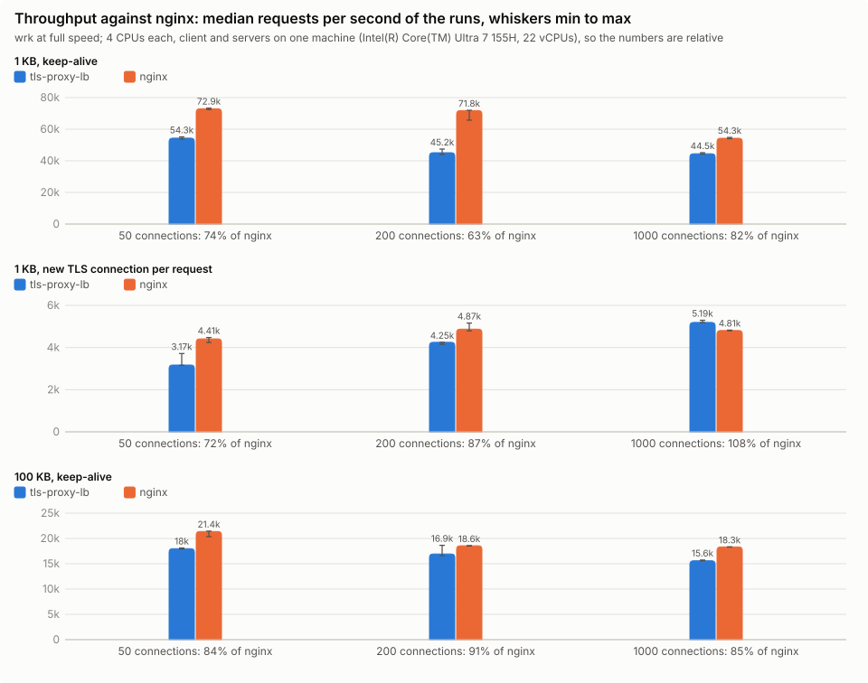
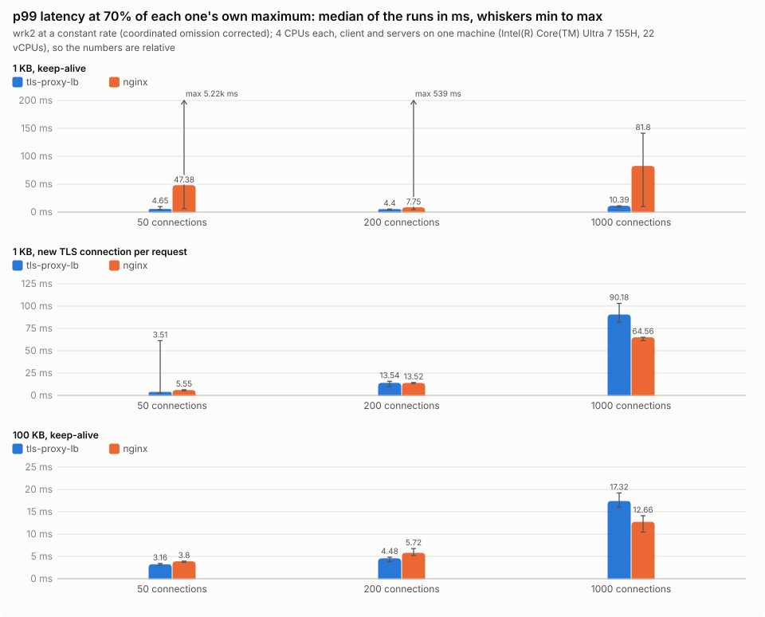
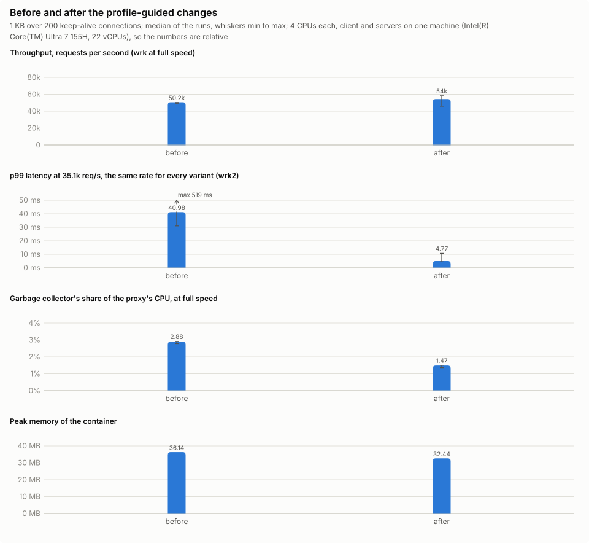
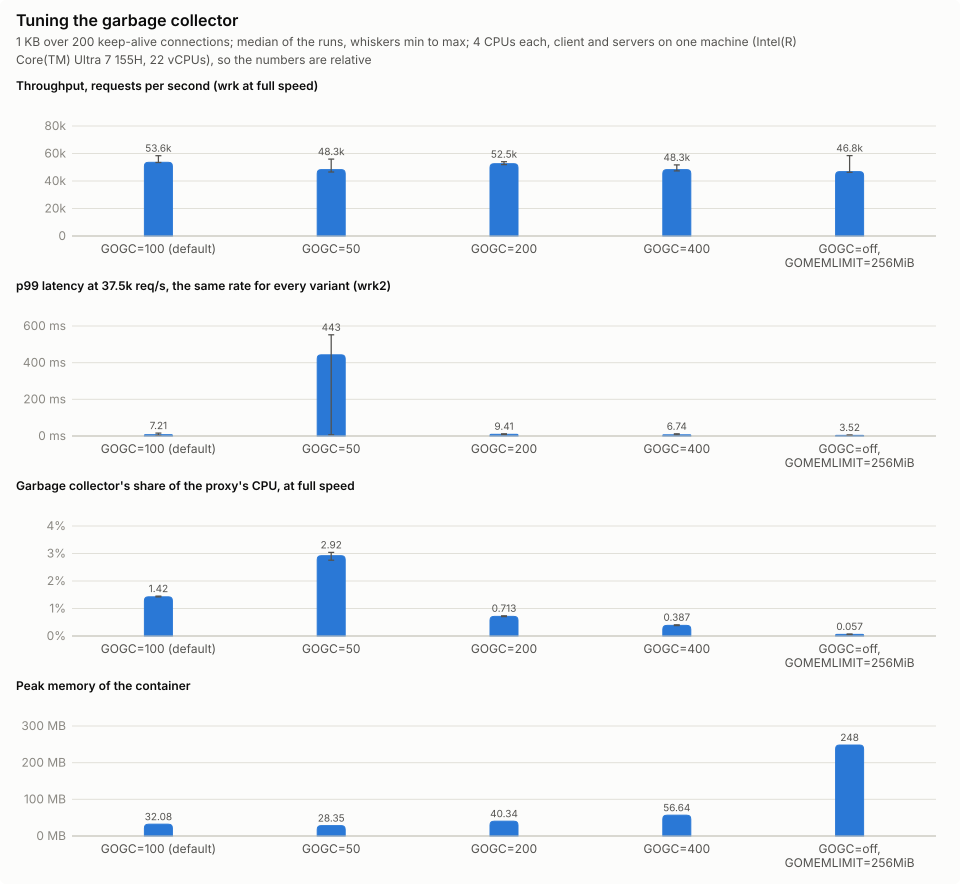
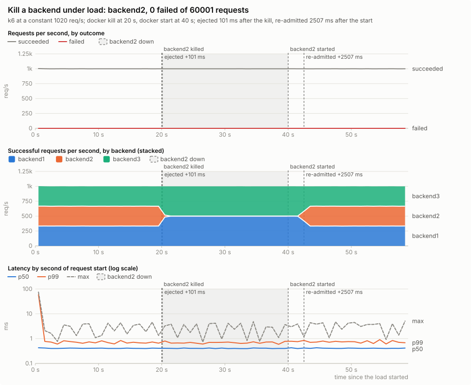
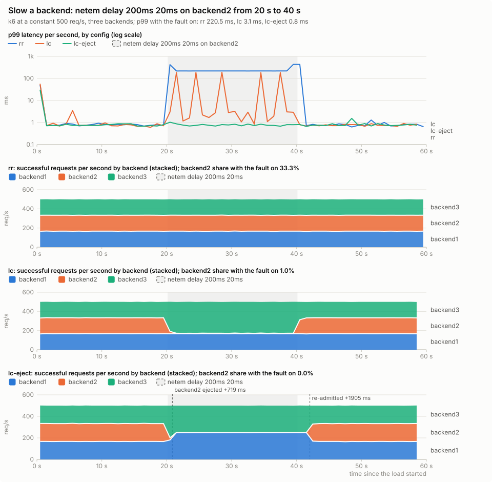
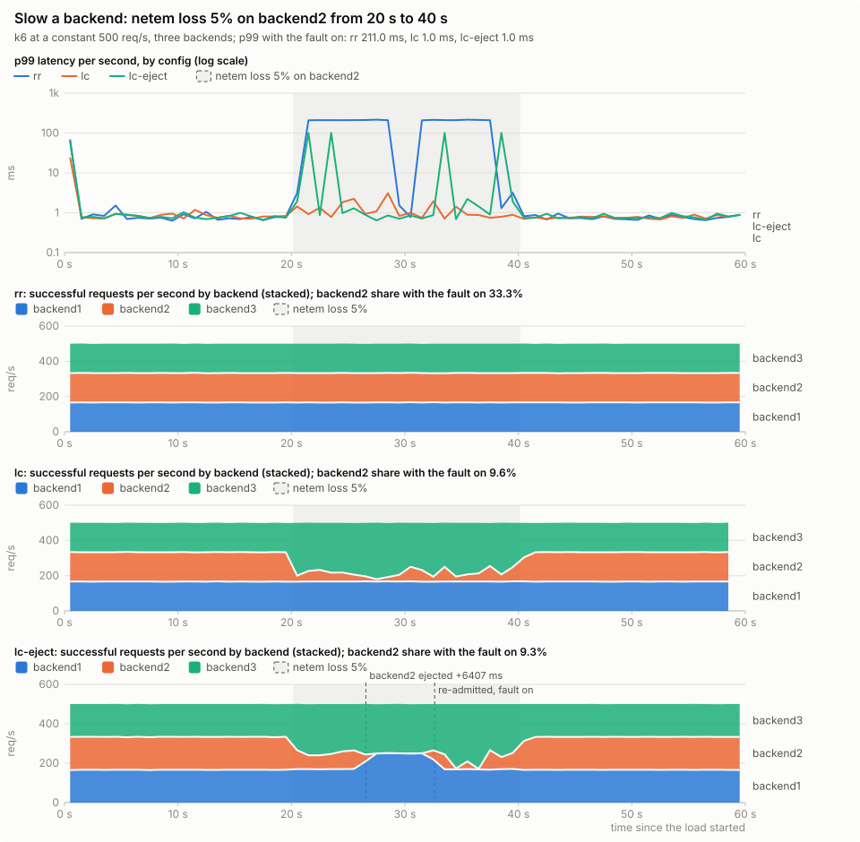
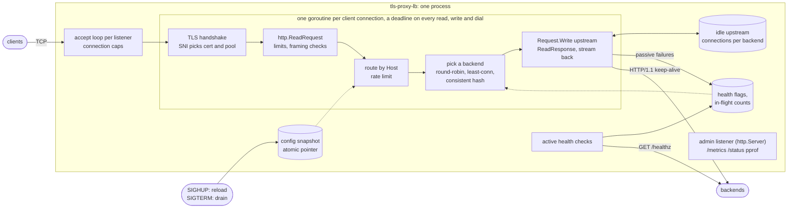

# tls-proxy-lb

An HTTP/1.1 reverse proxy and load balancer in Go. It terminates TLS,
picks a certificate and a backend pool by SNI, and balances requests
across the pool with health checks, retries, rate limits, hot reload and
graceful shutdown.

**One rule shapes the code:** the request path is built on `net` and
`crypto/tls` directly. From `net/http` it uses only the parsers and
serialisers (`http.ReadRequest`, `http.ReadResponse`, `Request.Write`,
`Response.Write` and `Header`), because hand-written HTTP parsers are
where request smuggling comes from. `http.Server`, `http.Transport`,
`http.Client`, `httputil.ReverseProxy` and `golang.org/x/time/rate` are
not on the request path. The accept loop, keep-alive, deadlines, the
upstream connection pool, the balancers and the token bucket are this
project's own. `http.Server` serves only the loopback admin listener, and
`http.Client` only health probes and tests. The third-party modules are
BurntSushi/toml, prometheus/client_golang, and goleak in tests.

**Status:** complete for the scope below. It was built in nine phases,
each recorded in [docs/DESIGN.md](docs/DESIGN.md) with its decisions and
measured results. CI runs gofmt, vet, staticcheck, govulncheck and every
test under the race detector on each push, then brings up the Docker lab
and checks it.

## Results

Three experiments, each rerun by a `make` target that rewrites its raw
results and graphs in [`bench/phase9/results/`](bench/phase9/results).
Every number below comes from those files. All three ran on one laptop
(hardware under [Method](#benchmark-method)), so the numbers compare the
proxy with nginx on the same machine; they are not capacity figures.

### A. Against nginx: 63 to 108% of its throughput



The proxy and nginx 1.30.6 take turns on the same four vCPUs, with the
same certificate and access logging on. Before anything is measured, the
benchmark checks that both negotiate the same TLS (1.3,
`TLS_AES_128_GCM_SHA256`, `X25519MLKEM768`). Both sit in front of the
same two nginx origins. With 1 KB responses on keep-alive connections,
the proxy serves 63 to 82% of nginx's requests a second; with 100 KB, 84
to 91%. With a full TLS handshake per request, cryptography dominates for
both: 72 to 108%, and the proxy is ahead at 1,000 connections. On
keep-alive the proxy spends about 20% more CPU per request than nginx (66
µs against 54 µs at 50 connections). Its profile has no single hotspot
left: over half its CPU is the kernel's loopback send and receive, and
the rest is spread thinly over TLS, `net/http`'s parsers, deadlines and
the access log. Nor is the gap the garbage collector, which takes 1.2 to
2.1% of the proxy's CPU on 1 KB keep-alive; most of what the proxy still
allocates (2.2 KB a request) is inside `net/http`'s parsers.



wrk2 runs each device at 70% of its own maximum, so the proxy's runs are
at lower rates than nginx's. With 1 KB on keep-alive, the proxy's p99
stays between 4 and 12 ms in every run. nginx's swings from 5 ms to
seconds between runs of one cell; the clipped whiskers carry the
maximum. In six reruns of the 50-connection cell, how evenly nginx's
four workers shared the CPU did not predict the tail (the slowest run,
26 ms, was among the most even), so it is not `reuseport`'s hashing; its
cause is not known. With a handshake per
request, or 100 KB, at 1,000 connections, nginx's p99 is lower (65 against
90 ms, and 13 against 17 ms). The proxy's peak memory is 20 to 152 MB
against nginx's 41 to 160 MB, and garbage collection is 0.5 to 9% of its
CPU, the most with a handshake per request.
`make bench`; [summary](bench/phase9/results/bench/summary.txt),
[raw runs](bench/phase9/results/bench/raw).

#### Profiling: the access log was the hotspot



CPU, allocation and mutex profiles under load (`make bench-hotspots`
keeps them in [`results/hotspots`](bench/phase9/results/hotspots)) had
one cost the proxy controls standing out: the access line, written through
`slog`'s JSON handler. It was 41% of the bytes allocated, 11% of CPU,
and 47% of the time goroutines spent waiting on a mutex, since `slog`
holds one lock around every line. The proxy now encodes the line itself into
a reused buffer, byte for byte what `slog` wrote, and writes it once. At
the same rate, p99 fell from 41 to 4.8 ms (every run before, 31 to 519
ms, was slower than every run after, 4.4 to 10.8 ms). Allocations fell
from 3.7 to 2.2 KB per request, mutex wait from 9.3 s to 1.0 s in 30 s,
CPU per request by 11%, and the GC's share of CPU from 2.9 to 1.5%. Throughput rose 7.6%, which is within
run-to-run spread. The next item, setting a deadline per read and write
(about 3% of CPU), stays: coalescing deadlines would weaken the timeouts
for a gain smaller than the noise.

#### Tuning the garbage collector: the default stays



The sweep ran at 200 keep-alive connections, with every latency run at
one rate. GC takes 1.4% of the proxy's CPU at the default `GOGC=100`,
so no setting can buy more than that. The throughput differences
between settings (up to 13%) are larger than that, so they are the
machine, not the collector. Each step up in `GOGC` halved the GC's share
(0.7% at 200, 0.4% at 400) and raised peak memory (40 MB, 57 MB, from
32). `GOGC=off` with `GOMEMLIMIT=256MiB` nearly removes GC (0.06%) and
had the lowest p99 (3.5 against 7.2 ms, inside the default's range of
3.3 to 15.8), but holds 248 MB, eight times the default. `GOGC=50`
doubled the GC's share and had p99s over 400 ms in two of its three
runs. The proxy keeps the default; `GOMEMLIMIT` is worth setting as a
ceiling in a container, not as a speed-up.
`make bench-gc`; [summary](bench/phase9/results/gc/summary.txt).

### B. Kill a backend under load: no failed requests



k6 sends 1,000 requests a second to three backends for 60 s. At 20 s
`docker kill` removes backend2 together with its network namespace, so
nothing resets the proxy's connections; at 40 s `docker start` brings it
back. Not one of the 60,001 requests failed. Three failures in a row
ejected the backend 101 ms after the kill, retries sent those requests to
the other two, and the 102 requests in that window had a p99 of 0.73 ms.
Active checks re-admitted it 2.5 s after it started (two passing checks a
second apart). `make demo-kill`;
[summary](bench/phase9/results/kill/summary.txt).

### C. Slow a backend with netem: least-connections routes around it



At 500 requests a second, `netem delay 200ms 20ms` on backend2 from 20 to
40 s, under three configs. Round-robin keeps sending it a third of the
requests, so p99 with the fault on is 220 ms. Least-connections sends it
only 1.0% of requests with the fault on, since the slow backend holds its
requests longest, and p99 is 3.1 ms. With passive ejection on a 100 ms
response timeout, the backend is out 719 ms after the fault starts, p99
stays at 0.80 ms, as it was before the fault, and the backend is back
1.9 s after the fault clears. No request failed in any run.



The same with `netem loss 5%`. Round-robin's p99 is 211 ms, from
retransmissions, and a lost SYN costs a 1 s connect retry. Least-connections cuts
backend2's share to 9.6% and p99 to 1.0 ms. Passive ejection does little
more under loss: three failures in a row are rare, so the backend was
ejected only 6.4 s into the fault, and active checks, which loss rarely
fails twice running, re-admitted it 6.1 s later with the loss still on.
`make demo-slow`;
[delay](bench/phase9/results/slow/summary-delay.txt),
[loss](bench/phase9/results/slow/summary-loss.txt).

## Quick start

Needs Linux (WSL2 works), Docker with Compose v2, Go as pinned in
`go.mod` (it builds the plotting tool), `make` and `openssl`.

```sh
git clone https://github.com/Starscourge/tls-proxy-lb.git
cd tls-proxy-lb
make demo-kill
```

This creates a local CA and certificates in `lab/certs`, builds the
images and starts the lab: the proxy, three backends and a load
generator. Then it runs experiment B, which takes about two minutes,
prints its summary, and rewrites `bench/phase9/results/kill/`, graph
included. `make demo-slow` (about eight minutes) and `make bench` (about
70 minutes, plus `make bench-hotspots` and `make bench-gc`) regenerate the
rest. `make lab-down` stops the lab.

Each experiment first checks the machine's clock and stops with `kernel
tick is ..., not 10000` if another time daemon is skewing it, which
happened under WSL2 (see [DESIGN.md](docs/DESIGN.md#the-machines-clock-is-checked-because-it-was-wrong);
`sudo systemctl disable --now systemd-timesyncd` fixed it).

To run the proxy on its own, see [docs/USAGE.md](docs/USAGE.md).

## Architecture



One goroutine owns each client connection from the handshake to the
close, making blocking calls with deadlines that Go's runtime multiplexes
over epoll. Goroutines share only what the diagram shows as stores: the
config snapshot, swapped whole on reload; the health flags and in-flight
counters, as atomics; the upstream pools, one mutex each; a sharded
rate-limit table; and the metrics. Bodies stream through fixed buffers in
both directions, and a slow reader's blocked write is the backpressure.

## Features

- **TLS**: 1.2 and 1.3 (ECDHE with AES-GCM or ChaCha20-Poly1305 only),
  ML-KEM hybrid key exchange, session tickets. SNI picks the certificate
  and the pool on one port, with a default certificate for unknown names.
  `Host` must match the SNI (421 otherwise). testssl.sh finds no weak
  protocol or cipher.
- **Balancing**: round-robin, least-connections, or consistent hashing on
  the client IP or a header (160 virtual nodes per backend), per pool,
  from a TOML file. A pick allocates nothing, which CI checks.
- **Upstream connection pool**: idle keep-alive connections per backend,
  LIFO, checked with a non-blocking peek before reuse. Reuse doubles
  throughput against dialling per request.
- **Health**: active checks with rise and fall counts, and passive
  ejection after failures in live traffic. A failed request is retried on
  another backend when that is safe (after a failed dial, or an
  idempotent request with no body before any response byte).
- **Rate limits**: a token bucket per client and route, with 429 and
  `Retry-After`, `X-Forwarded-For` believed only from trusted proxies, and
  a per-IP connection cap at accept.
- **Reload and shutdown**: `SIGHUP` rereads the config and certificates
  without failing a request, and keeps backends' health and idle
  connections. `SIGTERM` stops accepting and drains requests in flight.
- **Hardening**: ambiguous framing refused (`Content-Length` with
  `Transfer-Encoding`, duplicate lengths, folded or bare-LF lines and
  more): all 46 payloads of a smuggling corpus are refused, and its 5
  well-formed controls served, slow clients cut off, limits on headers, bodies and
  requests per connection, and panics contained to one connection. Three
  fuzz targets run the real parsing code. Runs unprivileged.
- **Observability**: Prometheus `/metrics`, a JSON `/status` and pprof on
  a loopback admin listener, and a JSON access log line per request,
  buffered.

## Limitations

- **Every number is from one machine.** Client, proxy and origins shared
  a laptop, pinned to separate vCPUs. Under WSL2 those are virtual CPUs,
  which Hyper-V moves between the laptop's performance and efficiency
  cores as it likes, and the CPU's sustained clock is well below its
  turbo clock. Each cell warms up for 20 s and reports the median of
  three runs with the range, but the numbers compare the proxy with nginx
  on this machine. They are not capacity figures.
- **Loopback, not a network.** The benchmark's traffic never crosses a
  NIC, so the kernel's send and receive work lands on the proxy's own
  CPUs, which is over half of its CPU time. On a real network that
  share, and both proxies' throughput, would differ. Docker's bridge was
  tried and rejected for adding noise larger than the differences being
  measured.
- **Throughput drifts between sessions.** The same build and settings
  served a median of 54,000 requests a second at 200 connections in the
  hotspot and GC runs, and 45,000 in the main benchmark an hour later.
  Single runs of one setting ranged from 46,000 to 58,000. The proxy's
  and nginx's cells run back to back, so the percentages compare like
  with like, but a difference smaller than the ranges means nothing.
- **The tail is noisy.** A single latency run sometimes shows a p99 tens
  or hundreds of times its siblings'. The tables give the median and
  range of three runs, so one outlier shows in the range and not in the
  median; when two of the three are hit, as for nginx at 50 connections
  and for `GOGC=50`, the median is too.
- **Latency is measured at each device's own 70%.** wrk2 drives each
  proxy at 70% of its own measured maximum, so their latency runs are at
  different rates.
- **HTTP/1.1 only.** No HTTP/2 or HTTP/3, no WebSockets (`Upgrade` is
  stripped, so the request goes as a plain one, and a backend's 101 is a
  502), no TLS to backends, caching, compression, OCSP stapling,
  weighted balancing or binary upgrade without dropping connections.
- **Passive ejection is made for failures, not loss.** Three failures in
  a row eject a backend quickly when it dies or stalls past the response
  timeout. Packet loss rarely gives three in a row: under 5% loss
  least-connections helped more than ejection did, and a lost SYN costs
  the 1 s connect timeout.
- **Rate limits and health are per process.** Several proxies in front of
  one pool would each hold their own buckets and their own view of the
  backends.
- **The demos need a trustworthy clock.** They time a kill and a fault
  against the proxy's log, so they refuse to run when the kernel clock is
  being skewed.

## Benchmark method

| | |
|---|---|
| Machine | Intel Core Ultra 7 155H laptop, 22 vCPUs and 7.5 GiB given to WSL2 |
| Kernel | Linux 6.6.87.2-microsoft-standard-WSL2, clock source `hyperv_clocksource_tsc_page` |
| Docker | 29.9.3, Docker Desktop; every container on the host's network (loopback) |
| Go | 1.27.4, in `go.mod` and the proxy image |
| nginx | 1.30.6, Debian image, OpenSSL 3.5.7 (`libssl3t64 3.5.7-1~deb13u3`) |
| Load | wrk 4.2.0 and wrk2 (commit 44a94c17d8e6), both built never to resume a TLS session, OpenSSL 3.5.9 |
| CPUs | device under test 2,4,6,8; origins 10-11 and 12-13; load generator 14-21 (Docker cpusets) |

Each device, the proxy with `GOMAXPROCS=4` or nginx with four workers,
runs alone on the same four vCPUs, behind the same address and
certificate. Two nginx origins serve fixed 1 KB and 100 KB files and are
never the limit (about one of their two cores each). Before measuring,
`bench.sh` checks that the two devices negotiate the same TLS version,
cipher suite and key exchange, and that they have the same number of
workers. Both write a JSON access line per request, buffered, to
`/dev/null`.

Every cell (scenario, connections, device) starts on a freshly created
container and 20 s of load at full speed, thrown away, so that the
laptop leaves its turbo clock for its sustained one. Then come three
15 s wrk runs at full speed, and three 40 s wrk2 runs at 70% of that
device's median throughput, each after 5 s at full speed. The proxy's and
nginx's cells for one scenario and connection count run back to back.
The load generator is eight single-thread wrk or wrk2 processes, with
connections and rate split evenly between them, since threads in one
process contend on OpenSSL's locks. A run's percentiles come from the
processes' wrk2 latency histograms merged. A new-connection run fails
unless the machine accepted at least 0.9 TCP connections per request. CPU
time and peak memory come from each container's cgroup, and the GC's
share from the proxy's runtime metrics.
[DESIGN.md](docs/DESIGN.md#phase-9-benchmarks-failure-demos-and-write-up)
gives the reason for each of these choices, and the alternatives
rejected. The scripts are in [`bench/phase9`](bench/phase9).

<details>
<summary>The proxy's config, <code>bench/phase9/bench/proxy.toml</code></summary>

```toml
# The proxy under test in the Phase 9 nginx benchmark (bench/phase9/bench.sh).
# Kept as close to nginx-proxy.conf as the two allow; docs/DESIGN.md
# (Phase 9) lists each pairing. Everything not set here is the default.
default_pool = "origin"

[[listener]]
address = "127.0.0.1:8443"

# Unknown SNI (default.test has no route) gets this certificate and the
# default pool, as nginx's default_server does.
[tls]
default_cert = "certs/default.test.crt"
default_key  = "certs/default.test.key"

[pool.origin]
algorithm = "round_robin"
backends  = [
  { address = "127.0.0.1:8081" },
  { address = "127.0.0.1:8082" },
]

# nginx: keepalive 64 idle connections per worker, 4 workers, 256 in all;
# here 128 per backend address, 256 in all.
[upstream]
max_idle_per_backend = 128

# No cap on requests per client connection (nginx: keepalive_requests
# 10000000). With the default 1,000 both close each connection every
# thousand requests, and wrk2 counts the reconnect as seconds of latency
# for every request queued behind it; the new-connection scenario measures
# connection set-up on its own. nginx: keepalive_timeout 60s.
[limits]
max_conns             = 20000
max_requests_per_conn = 0

[timeouts]
idle_ms = 60000

[admin]
address = "127.0.0.1:9901"
```

</details>

<details>
<summary>nginx's config, <code>bench/phase9/bench/nginx-proxy.conf</code></summary>

```nginx
# nginx under test in the Phase 9 benchmark (bench/phase9/bench.sh): the
# plan's upstream block, with settings matched to proxy.toml where the two
# have one. docs/DESIGN.md (Phase 9) lists each pairing.
worker_processes 4;             # = the proxy's GOMAXPROCS
worker_rlimit_nofile 65536;
error_log /dev/stderr warn;
pid /tmp/nginx-dut.pid;

events {
    worker_connections 16384;
}

http {
    # Access logging on both sides, each with a 64 KB buffer flushed every
    # second, written to /dev/null: the cost of formatting and writing each
    # line, without a disk. The fields are the proxy's access-log fields.
    log_format bench escape=json '{"time":"$time_iso8601","client":"$remote_addr",'
        '"scheme":"$scheme","method":"$request_method","host":"$host","path":"$uri",'
        '"status":$status,"backend":"$upstream_addr","upstream_ms":"$upstream_response_time",'
        '"total_ms":"$request_time","bytes_in":$request_length,"bytes_out":$bytes_sent,'
        '"sni":"$ssl_server_name","tls_version":"$ssl_protocol","tls_resumed":"$ssl_session_reused"}';
    access_log /dev/null bench buffer=64k flush=1s;

    keepalive_timeout  60s;          # proxy: idle_ms 60000
    # proxy: max_requests_per_conn 0, no cap. See proxy.toml.
    keepalive_requests 10000000;
    server_tokens off;

    upstream pool_a {
        server 127.0.0.1:8081;
        server 127.0.0.1:8082;
        keepalive 64;
    }

    server {
        # A listening socket per worker: without it, the connections a
        # load generator opens in one burst land unevenly (one worker took
        # twice another's load and saturated while the rest idled).
        listen 127.0.0.1:8443 ssl default_server reuseport;

        ssl_certificate     /etc/nginx/certs/default.test.crt;
        ssl_certificate_key /etc/nginx/certs/default.test.key;

        # What the Go proxy negotiates with this client (bench.sh checks
        # both with openssl s_client): TLS 1.3, TLS_AES_128_GCM_SHA256,
        # X25519MLKEM768. Go prefers AES-128-GCM where AES is in hardware;
        # OpenSSL follows the client, which lists AES-256-GCM first, unless
        # told to prefer its own order. TLS 1.2 is the proxy's suite list.
        ssl_protocols TLSv1.2 TLSv1.3;
        ssl_prefer_server_ciphers on;
        ssl_conf_command Ciphersuites TLS_AES_128_GCM_SHA256:TLS_AES_256_GCM_SHA384:TLS_CHACHA20_POLY1305_SHA256;
        ssl_ciphers ECDHE-ECDSA-AES128-GCM-SHA256:ECDHE-RSA-AES128-GCM-SHA256:ECDHE-ECDSA-AES256-GCM-SHA384:ECDHE-RSA-AES256-GCM-SHA384:ECDHE-ECDSA-CHACHA20-POLY1305:ECDHE-RSA-CHACHA20-POLY1305;
        ssl_ecdh_curve X25519MLKEM768:X25519:prime256v1:secp384r1;
        # Session tickets on, as the proxy has them; wrk never resumes.
        ssl_session_tickets on;

        location / {
            proxy_pass http://pool_a;
            proxy_http_version 1.1;
            proxy_set_header Connection "";
            # The proxy's request headers: Host kept, X-Forwarded-For set
            # to the client (overwritten, not appended), X-Forwarded-Proto.
            proxy_set_header Host $host;
            proxy_set_header X-Forwarded-For $remote_addr;
            proxy_set_header X-Forwarded-Proto $scheme;
            # The proxy streams bodies through fixed buffers. nginx buffers
            # responses by default and spills past its buffers to a temp
            # file; enough memory buffers for 100 KB and no temp file keep
            # it off the disk, which is nginx at its best rather than its
            # default.
            proxy_buffer_size 16k;
            proxy_buffers 16 16k;
            proxy_max_temp_file_size 0;
        }
    }
}
```

</details>

## Documentation

- [docs/USAGE.md](docs/USAGE.md): running the proxy, every config setting,
  reload and shutdown, privileges, the test backend, the Docker lab, and
  every `make` target.
- [docs/DESIGN.md](docs/DESIGN.md): each design decision, phase by phase,
  with the alternative rejected and why.
- [docs/THREAT_MODEL.md](docs/THREAT_MODEL.md),
  [docs/SMUGGLING.md](docs/SMUGGLING.md) and
  [docs/FUZZING.md](docs/FUZZING.md): what the proxy defends against and
  how that was tested.

## Layout

```text
cmd/proxy/         the proxy
cmd/testbackend/   test backend for tests and the lab
internal/          proxy packages (app, conn, httpx, tlsx, lb, upstream,
                   health, metrics, ratelimit, config, admin, logbuf) and
                   the test backend library
test/integration/  end-to-end tests and their helpers
bench/             benchmark and demo scripts and raw results, Phase 9's
                   in bench/phase9/
lab/               Docker Compose lab, certificate script
docs/              design decisions, usage, threat model, smuggling and
                   fuzzing notes, testssl.sh reports
```
